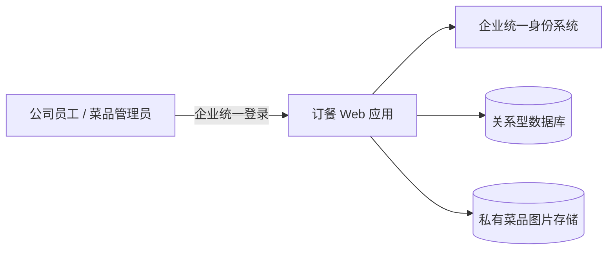
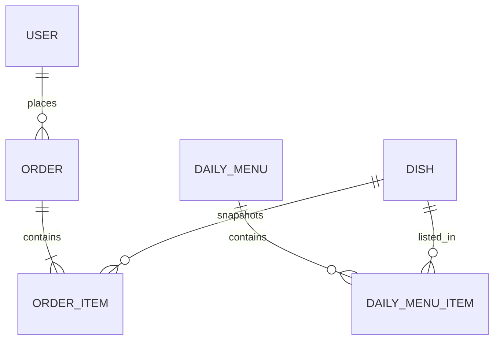
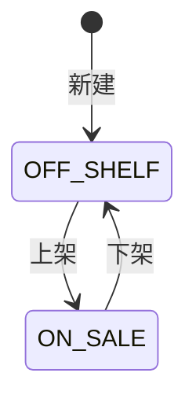
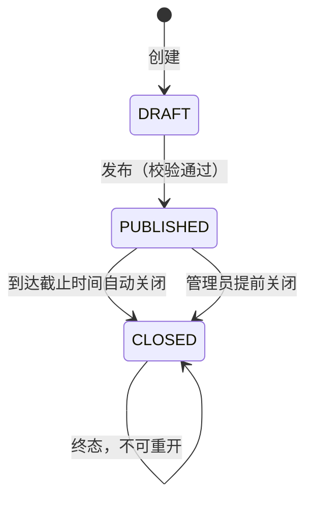
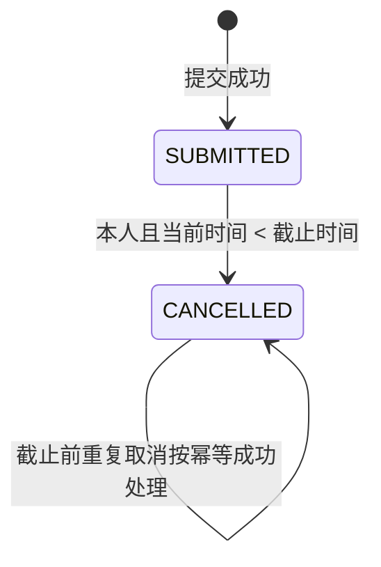
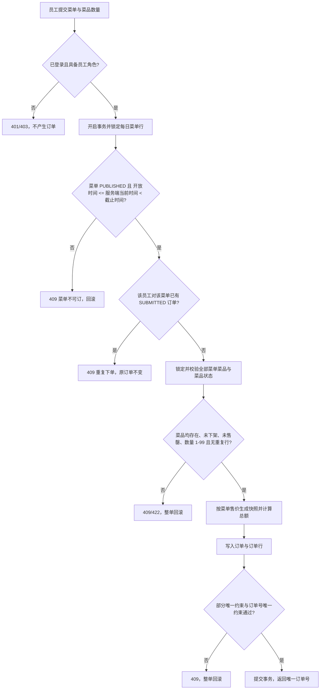

# 公司内部员工订餐网站 方案设计

| 项目 | 内容 |
| --- | --- |
| 平台工作项 | `issue-1794478812295026130` |
| 依据 | `requirement.md` v1.1（2026-11-13） |
| 设计版本 | v1.0 |
| 设计日期 | 2026-11-13 |
| 本期范围 | 员工午餐订餐、菜品管理、每日菜单管理、菜品图片上传/替换/移除 |
| 关键人工决策 | A-11 至 A-16 本期不做；A-17 中的菜品图片上传本期纳入，移动端适配、通知、多语言仍不做 |

## 1. 方案概述与关键决策

### 1.1 方案概述

本期建设一个单公司、单食堂、仅午餐 `LUNCH` 的公司内部 Web 订餐系统，包含两个业务面：

- 员工面：企业统一登录、查看当前开放菜单及菜品图片、管理购物车、提交订单、查看本人订单、截止前取消本人订单。
- 管理面：菜品资料维护、菜品图片上传/替换/移除、每日菜单草稿与发布、菜单菜品与售价维护、售罄切换、菜单关闭。

系统采用“服务端为唯一事实来源”的设计：页面可做即时反馈，但身份、角色、菜单可订状态、菜品可订状态、金额、订单唯一性和图片合法性全部由服务端最终校验。前端购物车不是业务凭据，提交时只提交菜单、菜品标识和数量；价格与总额一律由服务端按当前菜单售价重新读取并计算。



本期不涉及支付、退款、配送、库存扣减、取餐核销、消息通知、移动端专项适配、多租户、多食堂或角色管理界面。

### 1.2 关键决策及取舍

| 编号 | 决策 | 取舍理由 |
| --- | --- | --- |
| KD-01 | 采用 B/S Web 应用，服务端集中授权和校验 | 满足桌面 Chrome/Edge 使用的假设，避免把权限和金额可信度放在浏览器端；代价是所有关键校验需多一次服务端请求。 |
| KD-02 | 身份完全依赖企业统一登录，不建设本地账号密码 | `A-02` 已假设存在 SSO。由身份系统提供稳定的 `user_id`、姓名、部门、角色和账号状态；代价是 SSO 不可用时系统无法登录，但不扩大本期范围。 |
| KD-03 | 使用支持事务、行锁和条件唯一约束的关系型数据库 | 订单、菜单状态、首单锁定和“一人一菜单一有效订单”必须原子完成；相比最终一致方案，能直接消除部分写入和并发重复订单。 |
| KD-04 | 以 `(user_id, menu_id) WHERE status='SUBMITTED'` 的部分唯一约束保证单笔有效订单 | 数据库层兜底并发提交，避免仅靠“先查再插”的竞态；取消后的旧订单不再占用该唯一条件。 |
| KD-05 | 订单保存菜品名称、菜单售价、数量和金额快照，金额只由服务端计算 | 直接满足历史订单不可变和客户端伪造合计无效；代价是订单与当前菜品资料会有意解耦。 |
| KD-06 | 同一 `service_date + meal_period` 只能存在一个每日菜单，草稿、已发布、已关闭状态都占用该唯一名额 | 直接满足 AC-26，避免同一天同一餐次出现两个口径；代价是误建菜单在当前范围内无法通过删除重建纠正。 |
| KD-07 | 金额统一人民币分；业务时间按 `Asia/Shanghai` 解释，数据库存储带时区时间 | 避免浮点误差和时区歧义；`Asia/Shanghai` 不涉及夏令时。 |
| KD-08 | 菜单自动关闭采用“定时任务 + 访问时同步校正”双机制 | 定时任务保证无人访问时也会持久化关闭；请求时校正保证截止边界对员工立即可见，不依赖任务执行间隔。 |
| KD-09 | 每日菜单草稿允许暂存“截止时间不晚于开放时间”的不完整数据，发布时才强制校验 | 这是满足 AC-30 “发布被拒绝且菜单保持草稿”的必要设计；草稿本身不作为可订菜单暴露。 |
| KD-10 | 每日菜单只要曾经成功提交过订单，即永久锁定服务日期、餐次、菜品清单、售价和时间；订单之后被取消也不解锁 | “产生首笔有效订单后”按历史事件解释，避免取消后改价或换菜；代价是运营调整只能关闭旧菜单，但同一日期餐次又不能另建菜单，故须在发布前核对。该取舍见第 8 节风险 R-03。 |
| KD-11 | 菜品的参考价变化不自动改变已加入每日菜单的当餐售价 | 参考价仅用于加入菜单时的默认值，防止改菜品主数据导致已经在售的菜单价格漂移。 |
| KD-12 | 菜品图片存私有对象存储，菜品表只保存当前图片的元数据和带版本的应用访问地址 | 每道菜天然只有一张当前图片；替换后生成新版本地址，避免浏览器缓存继续展示旧图。数据库与对象存储通过事务和补偿清理保持一致。 |
| KD-13 | 购物车只保存在浏览器会话中，不建立服务端购物车表 | 需求只要求加入、调整、移除和查看合计，未要求跨设备保存；服务端在提交时重新校验，避免购物车成为可信价格来源。 |
| KD-14 | 菜品管理员角色不提供任何员工订单查询入口或接口 | 直接满足角色隔离要求；管理员即使同时是员工，也只能通过员工接口查看自己的订单。 |
| KD-15 | 未登录页面使用 302 跳转企业登录；未登录接口使用 401；已登录但无权限使用 403；越权访问他人订单使用 404 | 页面跳转满足 AC-01；403/404 的区分满足 AC-03、AC-04、AC-05、AC-39，并避免泄露他人订单是否存在。 |

## 2. 角色与权限模型

### 2.1 身份与会话

1. 未登录访问者发起任意业务页面请求时，服务端不查询业务表，直接返回 `302` 并跳转企业统一登录页，登录成功后回到原地址。
2. 企业统一登录回调成功后，服务端以身份系统返回的稳定 `user_id` 建立会话，并同步 `name`、`department`、`employee_no`、`roles`、`account_status`。
3. 只有 `account_status=ACTIVE` 且至少拥有 `EMPLOYEE` 或 `MENU_ADMIN` 之一的用户才能建立有效业务会话；停用账号或没有任何角色的账号不获得业务权限。
4. 每次页面、接口和图片读取请求都在服务端重新校验会话、角色和数据归属，不依赖前端是否显示入口。
5. 多角色用户的有效权限是各角色权限的并集，但“管理员查看订单”的能力不存在；多角色用户只能在员工接口下操作自己的订单。

### 2.2 角色定义与可见范围

| 角色 | 可见范围 | 可执行操作 | 明确禁止 |
| --- | --- | --- | --- |
| 未登录访问者 | 仅登录入口 | 发起企业统一登录 | 查看任何菜单、价格、菜品图片、订单或后台数据 |
| 普通员工 `EMPLOYEE` | 当前处于开放窗口内的已发布菜单；自己的购物车；自己的全部订单（含已取消） | 查看当前菜单和菜品图片、加入/调整/移除购物车、提交订单、查看本人订单、截止前取消本人订单 | 进入菜品或每日菜单后台；上传/替换/移除菜品图片；查看他人订单；修改菜品、菜单价格或已生成订单 |
| 菜品管理员 `MENU_ADMIN`（无员工角色） | 全部菜品资料、全部菜品图片、全部每日菜单（含草稿） | 新增/编辑/上架/下架菜品；上传/替换/移除图片；创建/编辑/发布/关闭菜单；维护菜单菜品、售价、顺序和售罄状态 | 查看或修改任何员工订单；代替员工取消订单；修改角色或员工账号 |
| 双角色用户 `EMPLOYEE + MENU_ADMIN` | 同时具备上述两个可见范围 | 在员工接口下正常下单、查看和取消自己的订单；在管理接口下维护菜品和菜单 | 借助管理员身份查看任何人的订单；用管理权限绕过员工截止时间或订单归属 |

补充：`MENU_ADMIN` 是否同时具备员工身份由身份系统的角色集合决定；纯管理员角色没有订餐权限。

### 2.3 页面与接口权限矩阵

| 资源/操作 | 未登录 | 普通员工 | 纯菜品管理员 | 双角色 |
| --- | --- | --- | --- | --- |
| 登录入口 | 允许 | 允许 | 允许 | 允许 |
| 当前开放菜单及菜品 | `302` 登录 | 允许 | 允许（管理接口，可查看全部状态菜单） | 允许 |
| 未来、草稿、已关闭菜单 | `302` 登录 | 禁止，`403` | 管理接口允许 | 管理接口允许 |
| 购物车增删改与查看 | `302` 登录 | 允许，仅本人浏览器状态 | 禁止，`403` | 允许，仅员工功能 |
| 提交订单、查看本人订单、取消本人订单 | `302` 登录 | 允许 | 禁止，`403` | 允许，仅本人订单 |
| 查看他人订单 | `302` 登录 | 禁止，`404` | 禁止，`403` | 禁止，`404` |
| 后台菜品列表/详情/新增/编辑/上下架 | `302` 登录 | 禁止，`403` | 允许 | 允许 |
| 菜品图片读取 | `302` 登录 | 仅当前开放菜单中的菜品图片 | 允许全部菜品图片 | 按对应上下文允许 |
| 菜品图片上传/替换/移除 | `302` 登录 | 禁止，`403` | 允许 | 管理接口允许 |
| 每日菜单列表/草稿/创建/编辑 | `302` 登录 | 禁止，`403` | 允许 | 允许 |
| 发布、手动关闭菜单 | `302` 登录 | 禁止，`403` | 允许 | 允许 |
| 切换菜单菜品售罄状态 | `302` 登录 | 禁止，`403` | 允许 | 允许 |
| 员工订单列表/详情（管理端） | `302` 登录 | 不提供该资源 | 禁止，`403` | 禁止，`403` |
| 角色/账号管理 | `302` 登录 | 禁止，`403` | 禁止，`403` | 禁止，`403` |

### 2.4 拒绝语义与数据隔离

- 未登录页面请求：`302` 跳转企业统一登录，响应体不含业务数据。
- 未登录接口请求：`401 UNAUTHENTICATED`，响应体仅包含登录地址和错误信息，不含业务数据。
- 已登录但角色不具备权限：`403 FORBIDDEN`，页面与接口均不返回管理数据或订单数据。
- 员工请求他人订单详情、取消他人订单时：`404 ORDER_NOT_FOUND`，不披露该订单是否存在、订单号、菜品或金额。
- 员工请求订单列表时只返回 `user_id` 等于当前会话用户的订单，不提供按任意用户查询的参数。
- 管理端不设置订单查询功能；管理员访问订单列表或详情接口统一返回 `403`。
- 员工调用图片上传、替换、移除接口时，先做角色判断，直接返回 `403`，不读取或修改菜品图片。
- 双角色用户调用员工订单接口时，只能按当前 `user_id` 查询自己的订单；管理员角色不会放宽该条件。

## 3. 数据模型

### 3.1 通用约定

| 项目 | 约定 |
| --- | --- |
| 主键 | 业务实体使用服务端生成的 UUID/ULID 字符串；对外不要求连续数字 |
| 时间 | 数据库存 `TIMESTAMPTZ`（UTC），接口和页面按 `Asia/Shanghai` 展示；`service_date` 使用 `DATE`，表示上海当地服务日期 |
| 金额 | `BIGINT`，单位为人民币分，非负整数；页面以元显示并固定两位小数 |
| 字符 | “字符数”按 Unicode 字符计数；名称、分类去除首尾空格后校验 |
| 枚举 | 状态值使用固定枚举字符串，不接受任意文本 |
| 删除 | 本期不提供菜品、菜单、订单的物理删除或业务删除；已生成订单永久保留 |
| 数据库约束 | 业务关键唯一性、状态条件和非负金额同时由数据库约束与服务端校验保证 |

### 3.2 员工用户（`app_user`）

| 字段 | 类型 | 约束/说明 |
| --- | --- | --- |
| `user_id` | `VARCHAR(128)` | 主键；来自企业身份系统的稳定唯一标识，不可由客户端指定 |
| `employee_no` | `VARCHAR(64)` | 可空；非空时全局唯一 |
| `name` | `VARCHAR(200)` | 必填；去除首尾空格后长度 1 至 200 |
| `department` | `VARCHAR(200)` | 可空 |
| `roles` | 枚举集合 | 存储为 `user_role(user_id, role)`；`role` 仅允许 `EMPLOYEE`、`MENU_ADMIN`；每个用户至少一条 |
| `account_status` | 枚举 | `ACTIVE`、`DISABLED`；`DISABLED` 用户不能建立或继续使用业务会话 |
| `synced_at` | `TIMESTAMPTZ` | 最近一次从身份系统同步的时间；仅内部审计字段 |

角色只读自企业身份系统，本期不提供角色管理页面或写接口。

### 3.3 菜品（`dish`）

| 字段 | 类型 | 约束/说明 |
| --- | --- | --- |
| `dish_id` | `VARCHAR(64)` | 主键 |
| `name` | `VARCHAR(60)` | 必填；`TRIM` 后 1 至 60 字符 |
| `category` | `VARCHAR(30)` | 必填；`TRIM` 后 1 至 30 字符 |
| `description` | `VARCHAR(300)` | 可空；最多 300 字符；空字符串按未填写处理 |
| `reference_price_cents` | `BIGINT` | 必填；`>= 0`；仅作加入菜单时的默认售价，不参与既有菜单改价 |
| `image_url` | `VARCHAR(2048)` | 可空；当前图片的应用访问地址；为空表示无当前图片 |
| `image_mime_type` | `VARCHAR(32)` | 可空；有 `image_url` 时必填，仅允许 `image/jpeg`、`image/png`、`image/webp` |
| `image_size_bytes` | `INTEGER` | 可空；有 `image_url` 时必填，范围 1 至 5,242,880 字节 |
| `image_updated_at` | `TIMESTAMPTZ` | 可空；最近一次成功设置、替换或移除图片的时间 |
| `image_updated_by` | `VARCHAR(128)` | 可空；最近一次成功图片操作的管理员 `user_id` |
| `sale_status` | 枚举 | `ON_SALE`、`OFF_SHELF`；新建默认 `OFF_SHELF` |
| `created_at` | `TIMESTAMPTZ` | 非空；服务端时间 |
| `created_by` | `VARCHAR(128)` | 非空；创建管理员 |
| `updated_at` | `TIMESTAMPTZ` | 非空；最后成功修改时间 |
| `updated_by` | `VARCHAR(128)` | 非空；最后成功修改管理员 |

约束与规则：

- `image_url`、`image_mime_type`、`image_size_bytes` 必须同时为空或同时非空；不允许部分图片字段。
- `image_updated_at` 与 `image_updated_by` 同时为空或同时非空；移除图片后保留本次移除时间和操作人，用于审计，但三个“当前图片”字段均为空。
- 菜品名称不要求唯一；同一名称可存在多个菜品，以 `dish_id` 区分。
- 菜品上架/下架可双向切换；下架后不能被加入新菜单、不能出现在员工可订列表、不能参与新订单。
- 已被历史订单快照引用的菜品不物理删除；本期直接不提供菜品删除能力。
- 修改参考价不改动任何已加入菜单的 `unit_price_cents`。

### 3.4 每日菜单（`daily_menu`）

| 字段 | 类型 | 约束/说明 |
| --- | --- | --- |
| `menu_id` | `VARCHAR(64)` | 主键 |
| `service_date` | `DATE` | 必填；格式 `YYYY-MM-DD`，上海当地服务日期 |
| `meal_period` | 枚举 | 本期固定为 `LUNCH` |
| `order_open_at` | `TIMESTAMPTZ` | 必填；开放下单时间 |
| `order_cutoff_at` | `TIMESTAMPTZ` | 必填；截止下单时间 |
| `publish_status` | 枚举 | `DRAFT`、`PUBLISHED`、`CLOSED` |
| `published_at` | `TIMESTAMPTZ` | 可空；发布成功时写入 |
| `closed_at` | `TIMESTAMPTZ` | 可空；关闭时写入；自动关闭写为 `order_cutoff_at` |
| `created_at` | `TIMESTAMPTZ` | 非空；服务端时间 |
| `created_by` | `VARCHAR(128)` | 非空；创建管理员 |
| `updated_at` | `TIMESTAMPTZ` | 非空；最近一次管理员成功修改时间 |
| `updated_by` | `VARCHAR(128)` | 非空；最近一次管理员成功修改人 |

约束与规则：

- 唯一约束：`(service_date, meal_period)` 全状态唯一，即 `DRAFT`、`PUBLISHED`、`CLOSED` 都占用名额。
- `DRAFT` 可暂存不满足 `order_cutoff_at > order_open_at` 的时间组合，用于满足 AC-30；`PUBLISHED` 状态下必须满足 `order_cutoff_at > order_open_at`。
- `PUBLISHED`、`CLOSED` 状态下 `published_at` 必须非空；`CLOSED` 状态下 `closed_at` 必须非空。
- 发布还必须满足“至少一个 `availability=AVAILABLE` 且对应菜品 `sale_status=ON_SALE` 的菜单菜品”。
- 自动关闭不改写 `updated_at`/`updated_by`，因为不存在管理员修改；自动关闭的业务时间记录在 `closed_at`，值为 `order_cutoff_at`。
- 手动关闭、发布、菜单资料或菜单菜品变更由当前管理员操作，更新 `updated_at`/`updated_by`。
- 本期不校验 `service_date` 与订单时间窗的前后关系；需求未规定该关系，设计不额外增加限制。

### 3.5 每日菜单菜品（`daily_menu_item`）

| 字段 | 类型 | 约束/说明 |
| --- | --- | --- |
| `menu_id` | `VARCHAR(64)` | 联合主键之一；外键指向 `daily_menu` |
| `dish_id` | `VARCHAR(64)` | 联合主键之一；外键指向 `dish`；同一菜单内唯一 |
| `unit_price_cents` | `BIGINT` | 必填；`>= 0`；加入时默认复制菜品参考价，可由管理员在允许阶段修改 |
| `availability` | 枚举 | `AVAILABLE`、`SOLD_OUT` |
| `display_order` | `INTEGER` | 必填，默认 0；升序展示，同值按 `dish_id` 升序稳定排序 |

约束与规则：

- 一个菜单内同一菜品只允许一行；不允许重复行。
- 只允许把 `ON_SALE` 菜品加入新菜单；已存在于菜单中的菜品转下架后不自动删除该行，但不再可订。
- `unit_price_cents` 的变化不修改菜品参考价；菜品参考价变化也不修改该字段。
- 菜单菜品的增删、售价、顺序或售罄状态变更属于菜单编辑，成功后必须更新所属 `daily_menu.updated_at/updated_by`。

### 3.6 订单（`orders`）

| 字段 | 类型 | 约束/说明 |
| --- | --- | --- |
| `order_id` | `VARCHAR(64)` | 主键 |
| `order_no` | `VARCHAR(32)` | 非空、全局唯一；服务端生成，格式 `ORD-yyyyMMdd-XXXXXXXX`，日期取上海当地下单日期，`XXXXXXXX` 为大写字母数字随机串 |
| `user_id` | `VARCHAR(128)` | 非空；只能取当前登录员工 |
| `menu_id` | `VARCHAR(64)` | 非空；外键指向每日菜单 |
| `service_date` | `DATE` | 非空；提交时从菜单复制 |
| `meal_period` | 枚举 | 非空；提交时从菜单复制，本期为 `LUNCH` |
| `total_amount_cents` | `BIGINT` | 非空；`>= 0`；服务端按明细重新计算 |
| `note` | `VARCHAR(200)` | 可空；去除首尾空格后最多 200 字符，空值存 `NULL` |
| `status` | 枚举 | `SUBMITTED`、`CANCELLED` |
| `created_at` | `TIMESTAMPTZ` | 非空；提交成功时间，服务端时间 |
| `cancelled_at` | `TIMESTAMPTZ` | 可空；`CANCELLED` 时非空，`SUBMITTED` 时必须为空 |

约束与规则：

- 部分唯一约束：`UNIQUE (user_id, menu_id) WHERE status = 'SUBMITTED'`，保证同一员工对同一菜单最多一笔有效订单。
- `CANCELLED` 订单保留所有字段和明细；不得物理删除。
- `status=SUBMITTED` 时 `cancelled_at IS NULL`；`status=CANCELLED` 时 `cancelled_at IS NOT NULL`。
- 订单列表按 `created_at DESC, order_id DESC` 稳定排序；员工只能查询自己的记录。
- “首单锁定”触发条件：该 `menu_id` 存在至少一笔订单，无论当前状态是 `SUBMITTED` 还是 `CANCELLED`。每笔订单都因成功提交而产生，取消不回退该历史事实。

### 3.7 订单菜品快照（`order_items`）

| 字段 | 类型 | 约束/说明 |
| --- | --- | --- |
| `order_id` | `VARCHAR(64)` | 联合主键之一；外键指向订单 |
| `dish_id` | `VARCHAR(64)` | 联合主键之一；下单时对应菜品标识 |
| `dish_name_snapshot` | `VARCHAR(60)` | 非空；提交瞬间的菜品名称 |
| `unit_price_cents_snapshot` | `BIGINT` | 非空；提交瞬间的菜单实际售价，`>= 0` |
| `quantity` | `SMALLINT` | 非空；1 至 99 |
| `subtotal_cents` | `BIGINT` | 非空；必须等于 `unit_price_cents_snapshot × quantity` |

约束与规则：

- 同一订单内同一 `dish_id` 只允许一行；重复菜品行在提交时直接拒绝。
- 快照字段在订单创建后不可修改；菜品、菜单、图片后续变化不回写。
- 订单快照不保存图片、分类、描述、参考价或售罄状态；这些字段不属于订单计价和快照要求。
- 订单总额等于所有 `subtotal_cents` 之和，服务端在同一事务内计算并写入。

### 3.8 购物车（客户端临时模型）

购物车不落库，结构为：

```text
Cart {
  menuId: string,
  items: [{ dishId: string, quantity: integer }]
}
```

- 同一 `menuId` 下同一 `dishId` 只保留一行；再次加入同一菜品时数量累加。
- 数量范围为 1 至 99；数量改为 0 视为移除该行；累加后超过 99 时拒绝该次增加并保持原数量。
- 提交成功后清空当前菜单购物车；提交失败时保留购物车，便于员工移除或调整问题菜品。
- 前端展示的行小计和合计仅用于即时反馈；最终金额以服务端提交结果为准。
- 页面刷新可在同一浏览器会话中恢复购物车，但不跨设备、不跨用户、不提供服务端购物车接口。

### 3.9 实体关系与状态机



#### 菜品状态机



没有删除状态；历史订单引用的菜品永久保留。

#### 每日菜单状态机



- `DRAFT` 不可见给员工，可编辑菜单资料和菜品。
- `PUBLISHED` 在 `order_open_at <= 当前时间 < order_cutoff_at` 时对员工开放。
- `CLOSED` 为终态，不能重新发布或恢复为可订。

#### 订单状态机



本期没有完成、退款、异常处理或其他订单状态。

### 3.10 核心数据不变量

1. 同一员工对同一每日菜单至多一笔 `SUBMITTED` 订单。
2. 同一 `service_date + meal_period` 至多一个每日菜单。
3. 同一每日菜单内同一菜品至多一行。
4. 订单总额必须等于全部订单行小计之和，订单行小计必须等于快照单价乘数量。
5. 订单快照、总额、状态、下单时菜单信息一经提交不被菜品、菜单或图片变更改写。
6. 每道菜最多一个当前图片；图片三个当前字段同时为空或同时存在。
7. 同一菜单一旦存在任意订单，服务日期、餐次、菜品清单、售价和时间永久不可再改；只能切换售罄或关闭。
8. 每次管理员成功修改菜品或每日菜单，最后修改人和时间必须对应本次操作；自动关闭不是管理员修改，不覆盖最后修改人。

## 4. 关键流程

### 4.1 登录与角色路由

1. 用户访问任意员工页或管理页，服务端先检查会话。
2. 无会话且是页面导航：返回 `302` 到企业统一登录，保留原始业务路径；不查询、不返回任何菜单、价格、订单或后台数据。
3. 企业登录回调成功后，服务端校验断言并同步身份与角色；停用账号或无角色账号返回 `403` 且不建立业务会话。
4. `EMPLOYEE` 默认进入员工订餐页；`MENU_ADMIN` 默认进入菜品管理页；双角色用户同时可见两个入口，但员工订单接口始终只返回本人数据。
5. 每个后续请求都重新做服务端权限校验；页面入口隐藏不作为权限依据。

异常：

- 登录回调失败或断言过期：不建立会话，跳回登录页并提示“登录失败，请重试”。
- 直接访问管理页但无 `MENU_ADMIN`：返回 `403`，不渲染任何管理数据。
- 纯管理员访问员工订单接口：返回 `403`，不执行订单查询。

### 4.2 菜品维护

#### 新增菜品

1. 校验当前用户具有 `MENU_ADMIN`。
2. 校验名称、分类、描述、参考价；名称/分类按去首尾空格后计长度，参考价必须为非负整数分。
3. 无论请求是否携带上架状态，新建菜品一律以 `OFF_SHELF` 保存。
4. 写入 `created_at/created_by` 与 `updated_at/updated_by`，两者均为当前管理员和当前服务端时间。
5. 返回菜品详情并出现在后台菜品列表。

失败时（如名称为空、参考价为负）不新增菜品，返回 `422 DISH_INVALID`。

#### 编辑菜品

1. 允许编辑名称、分类、描述、参考价和上下架状态。
2. 允许把 `ON_SALE` 改为 `OFF_SHELF`，也允许反向恢复。
3. 修改参考价不追溯修改任何每日菜单售价。
4. 菜品改为下架后：不能再加入新菜单；从员工可订列表隐藏；已生成订单保持不变。
5. 成功后更新 `updated_at/updated_by`。
6. 本期不提供删除菜品接口。

#### 菜品审计

- 新建、编辑、上/下架、图片上传/替换/移除均视为菜品修改，成功后更新 `dish.updated_at` 与 `dish.updated_by`。
- 失败请求不更新时间、不改变任何菜品字段。

### 4.3 每日菜单创建、编辑与发布

#### 创建草稿

1. 管理员提交 `service_date`、`meal_period`、`order_open_at`、`order_cutoff_at`；本期 `meal_period` 只能为 `LUNCH`。
2. 校验同一服务日期和餐次不存在任何状态的其他菜单；存在则返回 `409 MENU_ALREADY_EXISTS`，原菜单不变。
3. 创建为 `DRAFT`。草稿保存阶段允许时间窗暂不合法（`order_cutoff_at <= order_open_at`），以便保存未完成信息并支持 AC-30 的发布拒绝场景。
4. 写入创建人、创建时间和最后修改人/时间。

#### 草稿维护菜品

- 只能加入 `sale_status=ON_SALE` 的菜品；下架菜品返回 `409 DISH_OFF_SHELF`，菜单不变化。
- 同一菜单加入同一菜品时拒绝 `409 MENU_ITEM_DUPLICATE`。
- `unit_price_cents` 未显式提供时复制菜品参考价；显式提供时必须是 `>= 0` 的整数分。
- 新菜单菜品默认 `availability=AVAILABLE`，`display_order=0`。
- 草稿内可增删菜品、改售价、改顺序、改售罄状态，并同步更新菜单最后修改人和时间。

#### 发布

发布必须在同一事务中全部满足：

1. 菜单当前为 `DRAFT`。
2. `order_cutoff_at > order_open_at`。
3. 当前服务端时间早于 `order_cutoff_at`；若已经到达或超过截止时间，返回 `422 PUBLISH_WINDOW_INVALID`，菜单保持 `DRAFT`。
4. 菜单至少有一个 `availability=AVAILABLE` 且对应菜品 `sale_status=ON_SALE` 的菜品；否则返回 `422 PUBLISH_NO_AVAILABLE_ITEM`，菜单保持 `DRAFT`。

满足后写入 `publish_status=PUBLISHED`、`published_at=当前时间`、`updated_at/updated_by`。若发布时已经进入开放窗口（`order_open_at <= 当前时间 < order_cutoff_at`），员工立即可见；若尚未到开放时间，则在开放时间到达后可见。

#### 已发布菜单编辑

- 发布后、首笔订单成功提交前：可调整服务日期、餐次、菜品清单、售价、展示顺序、开放时间和截止时间。
  - 修改服务日期/餐次必须继续满足全状态唯一约束，否则 `409 MENU_ALREADY_EXISTS`，原菜单不变。
  - 修改时间后必须满足 `order_cutoff_at > order_open_at` 且 `order_cutoff_at > 当前时间`，否则 `422 PUBLISH_WINDOW_INVALID`，原值不变。
  - 允许把菜单菜品全部移除；此时菜单仍为 `PUBLISHED`，但没有可下单菜品，员工端显示空菜单，不能提交订单。
- 首笔订单成功提交后（无论该订单之后是否取消）：服务日期、餐次、菜品清单、售价、展示顺序和下单时间窗永久锁定；尝试修改返回 `409 MENU_LOCKED`，原菜单和原订单均不变。
- 锁定后仍允许：
  - 将已有菜单菜品在 `AVAILABLE` 与 `SOLD_OUT` 之间切换。
  - 手动关闭菜单。
- `DRAFT` 不提供直接关闭或删除；只能发布后关闭。`CLOSED` 禁止编辑任何字段。

#### 手动关闭

- 仅 `PUBLISHED` 菜单可手动关闭。
- 成功后 `publish_status=CLOSED`、`closed_at=实际关闭时间`、更新 `updated_at/updated_by`。
- 关闭后员工不可再提交新订单；已提交订单保持原状态，仍可在截止时间前由本人取消。

### 4.4 员工浏览菜单与购物车

1. 员工进入订餐页后，服务端先对菜单做状态校正，仅返回 `publish_status=PUBLISHED` 且 `order_open_at <= 当前时间 < order_cutoff_at` 的菜单。
2. 菜单展示：服务日期、餐次、开放时间、截止时间。
3. 菜单菜品按 `display_order ASC, dish_id ASC` 排序，并读取菜品当前名称、分类、描述、图片和菜单当餐售价。
4. 下架菜品不出现在员工可订列表；`SOLD_OUT` 菜品仍展示，但明确显示“售罄”且不可加入购物车。
5. 每个可订菜品展示名称、分类、描述（为空不展示内容）、人民币单价、图片；有图片显示当前版本图片，无图片显示统一占位图。
6. 员工只能把 `PUBLISHED` 窗口内且 `availability=AVAILABLE` 且菜品 `ON_SALE` 的菜品加入购物车。
7. 购物车操作遵循 3.8 节；页面行小计 = 菜单当前售价 × 数量，合计 = 各行小计之和。
8. 菜单在页面打开后变化或关闭时，提交仍以服务端最新状态为准并返回明确错误；前端提示后刷新菜单/购物车状态。

### 4.5 提交订单

提交是服务端事务，客户端只提交 `menu_id`、菜品 `dish_id` 与数量，可选备注；客户端传入的价格或合计一律忽略。



精确步骤与规则：

1. 校验当前用户具有 `EMPLOYEE` 角色；纯管理员返回 `403`。
2. 开启数据库事务，以 `SELECT ... FOR UPDATE` 锁定目标 `daily_menu` 行。
3. 在锁内使用数据库服务端时间执行菜单状态校正和判断：`publish_status=PUBLISHED`、`order_open_at <= now < order_cutoff_at`；任何一项不满足则回滚并返回菜单不可订。
4. 在锁内查询该 `user_id + menu_id` 是否存在 `SUBMITTED` 订单；存在则返回 `409 DUPLICATE_ORDER`，不写任何数据。
5. 校验请求至少包含一行菜品；同一 `dish_id` 不得重复出现；数量必须为整数 1 至 99；备注最多 200 字符。
6. 按 `dish_id` 升序锁定本次涉及的菜单菜品行和菜品行，避免不同订单之间死锁。
7. 每个请求菜品必须存在于该菜单、菜品 `sale_status=ON_SALE`、菜单菜品 `availability=AVAILABLE`；任一不满足则整单失败。
8. 对每个菜品读取当前 `unit_price_cents`，生成 `dish_name_snapshot`、`unit_price_cents_snapshot`、`quantity`、`subtotal_cents`，计算 `total_amount_cents = Σ subtotal_cents`。
9. 写入订单：`user_id` 只取会话用户，`service_date/meal_period` 从菜单复制，状态固定为 `SUBMITTED`。
10. 写入全部订单行；订单号冲突时重试生成，仍冲突则整单失败。
11. 提交事务，返回 `201`、`order_no`、订单状态、总额和明细。事务内任一步失败必须全部回滚，不产生部分订单或部分明细。

客户端伪造合计：请求中的 `total` 不参与计算；以第 8 步计算值为最终值。该请求本身不构成错误，结果保存正确总额。

并发与重试：

- 同一员工同一菜单的两个并发提交由菜单行锁串行化，再由部分唯一约束兜底；最多一笔成功，另一笔返回 `409 DUPLICATE_ORDER`，原订单不变。
- 本设计不引入客户端幂等键；若首次提交已成功但响应丢失，用户再次提交会被 `409` 拒绝，用户可从“我的订单”确认已生成订单。一次合法提交只生成一笔订单。
- 菜单售价被管理员同时修改时，提交事务中读取到的当餐售价即为快照来源；锁定顺序保证提交与管理员修改线性化。

### 4.6 取消订单

1. 仅订单所属员工可取消；员工请求他人订单或不存在订单统一返回 `404 ORDER_NOT_FOUND`；管理员调用员工取消接口返回 `403`。
2. 开启事务并锁定订单行及对应菜单行。
3. 读取 `order_cutoff_at` 和订单状态，使用数据库服务端时间判断 `now < order_cutoff_at`；等于或晚于截止时间返回 `409 CANCEL_CLOSED`，订单状态不变（原 `SUBMITTED` 仍为 `SUBMITTED`，原 `CANCELLED` 仍为 `CANCELLED`）。
4. 若订单为 `SUBMITTED`，在同一事务写入 `status=CANCELLED`、`cancelled_at=当前时间`，保留全部订单行和快照。
5. 若订单已经是 `CANCELLED` 且当前时间仍早于截止时间，返回 `200` 和当前订单状态，不再产生状态变化；该处理保证重复请求安全。
6. 手动提前关闭菜单不阻断截止前的取消：首次有效取消只看本人、订单为 `SUBMITTED` 和 `now < cutoff`，不看菜单是否已提前 `CLOSED`。
7. 取消后原订单仍可在“我的订单”中查询完整明细、取消时间和快照；员工可在截止时间前对同一菜单重新提交新订单，旧订单不占用 `SUBMITTED` 唯一名额。

### 4.7 截止时间自动关闭

1. 定时任务每 60 秒扫描一次 `publish_status=PUBLISHED AND order_cutoff_at <= 数据库当前时间` 的菜单，并以条件更新方式改为 `CLOSED`，`closed_at=order_cutoff_at`。
2. 所有读取菜单、员工菜单列表、提交订单和取消订单的入口在事务/查询前执行相同状态校正；因此在截止时间点及之后，即使定时任务尚未运行，接口也按 `CLOSED` 处理。
3. 自动关闭不修改订单、不取消订单、不通知用户、不改变最后修改人；只更新菜单状态和 `closed_at`。
4. 自动关闭与提交并发时以菜单行锁串行化：提交先取得锁且判断时间早于截止则可成功，定时任务随后关闭；定时任务先关闭则提交看到 `CLOSED` 并失败。

### 4.8 菜品图片上传、替换、移除与展示

#### 操作入口与权限

- 上传：`PUT /admin/dishes/{dish_id}/image`，`multipart/form-data`，每次只允许一个文件。
- 替换：同一上传接口；已有当前图片时成功上传即替换，不保留旧图作为当前图。
- 移除：`DELETE /admin/dishes/{dish_id}/image`。
- 三个操作均要求 `MENU_ADMIN`；员工调用先返回 `403 IMAGE_FORBIDDEN`，不读写任何图片字段。

#### 上传校验

服务端按以下顺序校验，所有条件必须在写入数据库前完成：

1. 请求必须恰好包含一个文件；文件不得为空。
2. 实际字节数必须 `<= 5,242,880` 字节；超过返回 `413 IMAGE_TOO_LARGE`，提示“图片不能超过 5 MB”。
3. 不信任扩展名和客户端声明的 Content-Type；读取魔数并用完整解码器验证实际内容。
4. 实际内容必须可完整解码为 JPEG、PNG 或 WebP；GIF、BMP、SVG、PDF、文本、损坏文件及伪装成图片的文件均返回 `422 INVALID_IMAGE`，提示“仅支持 JPEG、PNG、WebP 图片”。
5. 校验成功后以实际解码出的 MIME 作为 `image_mime_type`，以原始上传字节数作为 `image_size_bytes`。

#### 原子保存与替换

1. 先把文件写入临时对象并完成全部验证。
2. 开启事务并锁定菜品行；生成新图片版本和新的不可变 `image_url`，写入 `image_url`、`image_mime_type`、`image_size_bytes`、`image_updated_at`、`image_updated_by`，同时更新 `dish.updated_at/updated_by`。
3. 事务提交后旧图片不再被任何响应返回；再清理旧对象。旧对象清理失败不改变当前图片和新地址，只记录运维告警。
4. 任一步校验或数据库写入失败：回滚事务、清理临时对象，原 `image_url`、MIME、大小、图片审计字段和菜品其他资料全部保持不变。
5. 两个管理员并发替换时由菜品行锁串行化；后提交者成为当前图片，成功响应均只返回各自提交后的当前图片。最终状态必须是某一个完整成功版本，不允许字段混合。

#### 移除

1. 锁定菜品行，将 `image_url`、`image_mime_type`、`image_size_bytes` 置空。
2. 将 `image_updated_at` 和 `image_updated_by` 写为本次移除管理员与时间，并更新菜品最后修改人/时间。
3. 提交后员工端和后台均展示统一占位图；旧对象后续清理，旧地址不再作为当前图片返回。
4. 重复移除按成功无副作用处理，仍返回占位状态。

#### 图片地址与缓存

- 每次上传/替换生成新的不可变版本地址，例如 `/media/dishes/{dish_id}/{version}`；`image_url` 一旦写入不对同一版本内容复用。
- 图片地址由应用鉴权后读取私有存储；未登录访问跳转登录，无权限返回 `403`，不公开存储桶。
- 因每次替换都改变 URL，浏览器缓存不会继续把旧图作为当前图片显示。

#### 占位图

- 无当前图片时，菜品详情返回 `image_url=null`，前端统一展示系统内置占位图。
- 占位图不展示原始文件名、不出现空白区域；图片加载失败时前端也回退到同一占位图，避免破图。
- 占位图不进入订单快照。

#### 图片与订单

图片操作只修改菜品图片字段和菜品审计字段，不修改任何订单、订单行、快照、金额或状态。图片不参与订单金额计算，也不作为订单快照字段。

### 4.9 异常与响应映射

| 场景 | HTTP | 业务错误码 | 数据影响 |
| --- | --- | --- | --- |
| 未登录访问业务页面 | `302` | `LOGIN_REQUIRED` | 跳转企业登录，不返回业务数据 |
| 未登录调用业务接口 | `401` | `UNAUTHENTICATED` | 不返回业务数据 |
| 员工访问菜品/菜单管理页或接口 | `403` | `FORBIDDEN` | 不展示管理数据 |
| 管理员访问员工订单列表/详情 | `403` | `FORBIDDEN` | 不返回订单内容 |
| 员工 A 请求员工 B 的订单或取消 B 的订单 | `404` | `ORDER_NOT_FOUND` | 不返回订单号、菜品或金额 |
| 菜单为草稿、未到开放时间、已关闭或超过截止时间仍提交 | `409` | `MENU_NOT_ORDERABLE` / `ORDER_CLOSED` | 不产生订单 |
| 购物车含售罄菜品、下架菜品或已移出菜单的菜品 | `409` | `ITEM_NOT_AVAILABLE` | 整单回滚，不产生订单 |
| 同一员工对同一菜单重复提交 | `409` | `DUPLICATE_ORDER` | 原订单不变，不产生第二笔 |
| 数量非整数、小于 1、大于 99，或请求无菜品 | `422` | `INVALID_QUANTITY` / `EMPTY_ORDER` | 不产生订单 |
| 备注超过 200 字符 | `422` | `INVALID_NOTE` | 不产生订单 |
| 截止后取消订单 | `409` | `CANCEL_CLOSED` | 订单保持 `SUBMITTED` |
| 菜品名称为空、分类为空、描述超长、参考价为负 | `422` | `DISH_INVALID` | 不新增或不变更菜品 |
| 同服务日期与餐次重复建菜单 | `409` | `MENU_ALREADY_EXISTS` | 原菜单不变 |
| 无可用菜品时发布 | `422` | `PUBLISH_NO_AVAILABLE_ITEM` | 菜单保持 `DRAFT` |
| 截止时间不晚于开放时间时发布 | `422` | `PUBLISH_WINDOW_INVALID` | 菜单保持 `DRAFT` |
| 首单后修改日期/餐次/清单/售价/时间窗 | `409` | `MENU_LOCKED` | 原菜单和订单不变 |
| 把下架菜品加入新菜单 | `409` | `DISH_OFF_SHELF` | 菜单不变 |
| 上传图片超过 5 MB | `413` | `IMAGE_TOO_LARGE` | 原图片和菜品资料不变 |
| 图片格式/内容不合法 | `422` | `INVALID_IMAGE` | 原图片和菜品资料不变 |
| 员工调用图片上传/替换/移除 | `403` | `IMAGE_FORBIDDEN` | 图片不变 |
| 图片地址未登录 | `302` | `LOGIN_REQUIRED` | 不返回图片 |
| 图片地址已登录但无读取范围 | `403` | `FORBIDDEN` | 不返回图片 |

所有页面级拒绝均不渲染业务数据；所有写操作失败均回滚，不保留部分修改。

## 5. 业务规则明细

### 5.1 需求规则映射

| 需求规则 | 本设计执行位置 |
| --- | --- |
| B-01 身份与权限 | 第 2 节、4.1、4.9；所有页面/接口/图片读取均在服务端校验 |
| B-02 可订条件 | 4.4、4.5、5.4：菜单 `PUBLISHED`、`open <= now < cutoff`、菜品 `ON_SALE`、菜单项 `AVAILABLE` 同时满足 |
| B-03 菜单发布 | 4.3、4.9：至少一个可订菜品且 `cutoff > open`，同时要求当前时间早于截止时间 |
| B-04 单笔有效订单 | 3.6、4.5、5.5：部分唯一约束与菜单行锁双重保证 |
| B-05 金额计算 | 4.5、5.3：服务端按菜单售价快照 × 数量求和，忽略客户端合计 |
| B-06 提交原子性 | 4.5、4.9、5.5：整单事务，任一菜品/菜单/时间/数量失败全部回滚 |
| B-07 快照不可变 | 3.7、5.4：订单行只读，后续菜品、菜单、售罄、下架、图片变更不回写 |
| B-08 取消时限 | 4.6、5.2：仅 `now < cutoff` 允许，`now >= cutoff` 拒绝 |
| B-09 货币与时间 | 3.1、5.2、5.3：人民币分、两位小数、`Asia/Shanghai` 解释 |
| B-10 数据保留 | 3.6、7：取消订单保留，本期不自动清理，不提供删除 |
| B-11 图片管理 | 3.3、4.8：仅管理员可上传/替换/移除，每菜一张，无图用占位图 |
| B-12 图片校验 | 4.8、5.6：实际内容 JPEG/PNG/WebP 且不超过 5,242,880 字节，失败全量回滚 |
| B-13 图片与订单 | 4.8、5.4：图片操作不改订单任何字段 |

### 5.2 时间规则

| 编号 | 规则 |
| --- | --- |
| T-01 | 所有业务时间按 `Asia/Shanghai` 解释和展示；`Asia/Shanghai` 当前无夏令时，不存在跳变歧义。 |
| T-02 | 数据库使用 `TIMESTAMPTZ` 存 UTC，时间比较使用数据库服务端时间，不信任客户端时间。 |
| T-03 | 员工可见和可提交的时间条件为 `order_open_at <= now < order_cutoff_at`；开放时刻包含，截止时刻排除。 |
| T-04 | 截止取消条件为 `now < order_cutoff_at`；`now = order_cutoff_at` 及之后一律拒绝取消。 |
| T-05 | 发布时要求 `order_cutoff_at > order_open_at` 且 `now < order_cutoff_at`；否则不发布，菜单保持 `DRAFT`。 |
| T-06 | 已发布菜单在首单前修改时间，必须满足 `cutoff > open` 且 `cutoff > now`；否则拒绝并保留原值。 |
| T-07 | 自动关闭在 `now >= cutoff` 时发生；`closed_at` 记录为 `order_cutoff_at`，而非任务实际执行时间。 |
| T-08 | 手动关闭的 `closed_at` 记录实际操作时间；手动提前关闭不影响截止前本人取消。 |
| T-09 | `service_date` 是上海当地日期，本期不强制其与开放/截止时间的前后关系。 |
| T-10 | 菜品、菜单所有管理员修改时间取数据库服务端时间；订单提交时间、取消时间同样取服务端时间。 |

### 5.3 数量与金额规则

| 编号 | 规则 |
| --- | --- |
| Q-01 | 单个菜品数量必须为整数 1 至 99；0 只能用于购物车移除，不能提交。 |
| Q-02 | 订单至少包含一行菜品；空订单拒绝提交。 |
| Q-03 | 同一订单内同一 `dish_id` 只允许一行；重复行返回 `422`。 |
| Q-04 | 购物车中再次加入同一菜品时数量累加；累加后超过 99 时拒绝本次增加，原数量不变。 |
| Q-05 | 行小计 `subtotal_cents = unit_price_cents_snapshot × quantity`；订单总额为全部行小计之和。 |
| Q-06 | 客户端提交的价格、行小计和总额全部不可信；服务端重新读取当前菜单售价并计算。 |
| Q-07 | 页面以元展示、固定两位小数，使用整数分转换，不使用浮点数计价。 |
| Q-08 | 参考价、菜单售价、快照单价、小计、总额均为非负整数分；参考价和菜单售价允许 0。 |
| Q-09 | 订单金额不包含折扣、税费、配送费、补贴、优惠券、积分或退款。 |
| Q-10 | 订单备注可空；去除首尾空格后最多 200 字符，空串按 `NULL` 保存。 |
| Q-11 | 金额使用 `BIGINT` 分；写入前校验求和溢出，溢出则整单拒绝并记录错误，不产生错误金额订单。 |

### 5.4 状态与可见性规则

| 编号 | 规则 |
| --- | --- |
| S-01 | 菜品新建必为 `OFF_SHELF`；之后可在 `ON_SALE` 与 `OFF_SHELF` 间切换。 |
| S-02 | `OFF_SHELF` 菜品不能加入新菜单、不出现在员工可订列表、不能用于新订单。 |
| S-03 | `SOLD_OUT` 菜单项仍在员工当前菜单中展示并标识“售罄”，但不可加入购物车或提交。 |
| S-04 | 实际可订 = 菜单 `PUBLISHED` + 处于开放窗口 + 菜品 `ON_SALE` + 菜单项 `AVAILABLE`，四项缺一不可。 |
| S-05 | 菜单状态只能 `DRAFT → PUBLISHED → CLOSED`；`CLOSED` 不可重开，`DRAFT` 不能直接关闭或删除。 |
| S-06 | 发布要求至少一个实际可订菜品；发布后允许全部售罄，此时员工可见菜单但无可提交菜品。 |
| S-07 | 菜单存在任意订单（含已取消）后，日期、餐次、菜品清单、售价、顺序和时间窗永久锁定；仅售罄切换与关闭允许。 |
| S-08 | 菜品下架或售罄、菜单关闭、菜单改价均不修改已经生成的订单状态和明细。 |
| S-09 | 取消后订单为 `CANCELLED`，可再次提交新订单；旧订单不删除、不占用有效订单名额。 |
| S-10 | 订单没有“完成”“退款”“异常”等其他状态；本期不实现订单后续流转。 |
| S-11 | 菜品名称变化后，新订单快照使用新名称；既有订单快照保持原名。 |
| S-12 | 图片上传、替换、移除与菜品上下架、菜单售罄相互独立；图片变化不改变可订状态。 |

### 5.5 并发与幂等规则

| 编号 | 规则 |
| --- | --- |
| C-01 | 提交订单必须锁定菜单行；同一菜单的提交、发布、编辑、关闭、自动关闭串行化。 |
| C-02 | 同一员工同一菜单的并发提交最多一笔成功；部分唯一约束 `(user_id, menu_id) WHERE status='SUBMITTED'` 是最终兜底。 |
| C-03 | 提交与取消均使用事务和行锁；事务内任一步失败全部回滚，不允许部分订单、部分明细或部分状态。 |
| C-04 | 管理员菜单编辑与员工提交并发时，以菜单行锁确定顺序；编辑先完成则提交使用新菜单，提交先完成则编辑按首单锁定拒绝。 |
| C-05 | 首单锁定判断与订单写入在同一事务内完成，避免“检查时无订单、写入时已有订单”的竞态。 |
| C-06 | 提交不使用客户端幂等键；重复提交按重复订单拒绝，一次成功提交只生成一笔订单。 |
| C-07 | 取消使用订单行锁；截止前并发重复取消只发生一次状态变更，其余请求返回当前已取消状态。 |
| C-08 | 截止后任何取消请求均返回 `409`；若订单仍为 `SUBMITTED`，必须保持该状态。 |
| C-09 | 图片上传/替换使用菜品行锁串行化；最终图片字段必须来自同一成功版本，不允许新旧版本混合。 |
| C-10 | 图片保存先验证临时对象再更新数据库；数据库失败不改变旧图片，提交后旧对象清理失败不影响当前状态。 |
| C-11 | 订单号由数据库唯一约束保证唯一；生成冲突时重试，仍冲突则整单失败。 |
| C-12 | 自动关闭任务与请求时校正均使用条件更新 `publish_status=PUBLISHED AND cutoff <= now`，重复执行安全。 |

### 5.6 输入校验

| 对象 | 字段 | 规则 | 失败行为 |
| --- | --- | --- | --- |
| 菜品 | `name` | 去首尾空格后 1 至 60 字符 | `422`，不新增/不修改 |
| 菜品 | `category` | 去首尾空格后 1 至 30 字符 | `422`，不新增/不修改 |
| 菜品 | `description` | 0 至 300 字符；空串存 `NULL` | `422`，不新增/不修改 |
| 菜品 | `reference_price_cents` | 整数、`>= 0`；元输入最多两位小数 | `422`，不新增/不修改 |
| 菜品 | `sale_status` | 仅 `ON_SALE`/`OFF_SHELF`；新建强制 `OFF_SHELF` | 非法枚举 `422` |
| 菜单 | `service_date` | 合法 `YYYY-MM-DD` 日期 | `422`，菜单不变 |
| 菜单 | `meal_period` | 本期仅 `LUNCH` | `422`，菜单不变 |
| 菜单 | 时间 | 发布时 `cutoff > open` 且 `cutoff > now` | `422`，保持 `DRAFT` 或原值 |
| 菜单菜品 | `unit_price_cents` | 整数、`>= 0` | `422`，菜单不变 |
| 菜单菜品 | `availability` | 仅 `AVAILABLE`/`SOLD_OUT` | `422`，菜单不变 |
| 菜单菜品 | `display_order` | 32 位整数，默认 0 | `422`，菜单不变 |
| 订单 | 菜品行 | 至少一行、菜品不重复 | `422`，不产生订单 |
| 订单 | `quantity` | 整数 1 至 99 | `422`，不产生订单 |
| 订单 | `note` | 去首尾空格后 0 至 200 字符 | `422`，不产生订单 |
| 图片 | 文件数量 | 恰好 1 个 | `422`，图片不变 |
| 图片 | 大小 | 1 至 5,242,880 字节 | `413`，图片不变 |
| 图片 | 实际内容 | 可完整解码的 JPEG/PNG/WebP | `422`，图片不变 |

### 5.7 审计与展示规则

| 编号 | 规则 |
| --- | --- |
| A-01 | 菜品新建/编辑/上下架/图片操作成功后，`updated_at` 和 `updated_by` 均更新为本次管理员和数据库服务端时间。 |
| A-02 | 每日菜单创建、资料编辑、菜品增删改、售价/顺序/售罄变化、发布、手动关闭成功后，`updated_at` 和 `updated_by` 更新为本次管理员和服务端时间。 |
| A-03 | 自动关闭只更新 `publish_status` 和 `closed_at`，不更新 `updated_at/updated_by`，避免把系统动作误记为管理员修改。 |
| A-04 | 失败请求不更新任何最后修改人/时间。 |
| A-05 | 员工菜单中的价格显示为菜单当餐售价，不显示菜品参考价；参考价只用于后台和加入菜单默认值。 |
| A-06 | 员工菜单展示当前菜品名称、分类、描述和图片；订单展示使用订单快照名称和单价。 |
| A-07 | 有图菜品展示当前版本图片；无图或加载失败展示统一占位图，不显示原始文件名。 |
| A-08 | 售罄菜品展示“售罄”标识；下架菜品不展示在员工可订列表。 |

## 6. 需求覆盖矩阵

| AC | 验收要点摘要 | 对应设计章节 | 覆盖结论 |
| --- | --- | --- | --- |
| AC-01 | 未登录访问员工页/后台页不展示数据并跳转统一登录 | 2.1、2.4、4.1、4.9 | 已覆盖 |
| AC-02 | 员工登录后进入订餐页并看到开放窗口内的已发布菜单 | 2.2、2.3、4.1、4.4、5.2 | 已覆盖 |
| AC-03 | 员工访问菜品/每日菜单管理页被拒并返回 403、无管理数据 | 2.3、2.4、4.1、4.9 | 已覆盖 |
| AC-04 | 菜品管理员访问员工订单列表/详情被拒并返回 403、无订单内容 | 2.2、2.3、2.4、4.9 | 已覆盖 |
| AC-05 | 员工 A 请求员工 B 订单详情返回 404 且不含 B 的订单信息 | 2.4、4.6、4.9 | 已覆盖 |
| AC-06 | 开放菜单菜品展示名称、分类、描述、单价、可订/售罄状态 | 4.4、5.7 | 已覆盖 |
| AC-07 | 售罄菜品显示“售罄”且不可加入购物车 | 4.4、5.4 | 已覆盖 |
| AC-08 | 数量 1 改 2 后行小计和订单合计准确翻倍 | 4.4、5.3 | 已覆盖 |
| AC-09 | 合法购物车只生成一笔订单，有唯一订单号并保存名称/单价/数量快照 | 3.6、3.7、4.5、5.5 | 已覆盖 |
| AC-10 | 伪造订单合计时服务端按菜单售价×数量重算并保存正确总额 | 4.5、5.3 | 已覆盖 |
| AC-11 | 同一员工同一菜单已有已提交订单时再次提交被拒且原订单不变 | 3.6、4.5、5.5 | 已覆盖 |
| AC-12 | 购物车含售罄菜品时提交失败且不产生订单 | 4.5、4.9、5.5 | 已覆盖 |
| AC-13 | 截止前取消后状态变已取消，取消时间和原明细仍可查询 | 3.6、4.6、5.2 | 已覆盖 |
| AC-14 | 已取消订单不占有效名额，截止前可对同一菜单重新提交 | 3.6、4.6、5.4 | 已覆盖 |
| AC-15 | 截止时间到达后提交新订单被拒 | 4.5、5.2 | 已覆盖 |
| AC-16 | 截止时间到达后取消订单被拒且订单保持已提交 | 4.6、5.2 | 已覆盖 |
| AC-17 | 草稿、未到开放时间或已关闭菜单不能提交订单 | 4.3、4.4、4.5、5.4 | 已覆盖 |
| AC-18 | 菜品名称或售价变更后已生成订单名称/单价/小计/总额不变 | 3.7、5.4、5.7 | 已覆盖 |
| AC-19 | 合法菜品保存成功，初始状态为下架并出现在后台列表 | 3.3、4.2 | 已覆盖 |
| AC-20 | 名称去空格后为空或参考价为负时拒绝保存且不新增 | 3.3、4.2、5.6 | 已覆盖 |
| AC-21 | 下架菜品不能加入新的每日菜单 | 4.3、5.4 | 已覆盖 |
| AC-22 | 下架菜品不出现在员工可订列表 | 4.4、5.4 | 已覆盖 |
| AC-23 | 每日菜单草稿对员工不可见 | 3.4、4.3、4.4 | 已覆盖 |
| AC-24 | 发布含至少一个可订菜品的菜单后，员工在开放时间可看到 | 4.3、4.4、5.2 | 已覆盖 |
| AC-25 | 每日菜单没有可订菜品时发布被拒且保持草稿 | 4.3、4.9、5.4 | 已覆盖 |
| AC-26 | 同服务日期和餐次重复创建菜单被拒且原菜单不变 | 3.4、4.3、5.5 | 已覆盖 |
| AC-27 | 首笔有效订单后修改日期/餐次/清单/售价被拒 | 4.3、5.4、5.5 | 已覆盖 |
| AC-28 | 菜单到达截止时间后自动变为已关闭 | 4.7、5.2 | 已覆盖 |
| AC-29 | 员工已提交订单后菜品售罄或下架，订单仍保持已提交且明细不变 | 3.7、5.4 | 已覆盖 |
| AC-30 | 截止时间不晚于开放时间时发布被拒且菜单保持草稿 | 3.4、4.3、5.2 | 已覆盖 |
| AC-31 | 菜品或每日菜单每次新增/编辑后更新最后修改人和时间 | 3.3、3.4、3.5、4.2、4.3、5.7 | 已覆盖 |
| AC-32 | 上传不超过 5 MB、实际 JPEG/PNG/WebP 并保存后详情显示且地址可访问 | 3.3、4.8、5.6 | 已覆盖 |
| AC-33 | 已开放菜单中设置图片的菜品同时展示名称和对应图片 | 4.4、4.8 | 已覆盖 |
| AC-34 | 无图片菜品在后台和员工端展示统一占位图，无破图/空白/文件名 | 4.8、5.7 | 已覆盖 |
| AC-35 | 不支持类型、伪装非图片或超 5 MB 时拒绝并保留原图片和资料 | 3.3、4.8、4.9、5.6 | 已覆盖 |
| AC-36 | 替换图片后后台和员工端展示新图，旧图不再作为当前图 | 4.8 | 已覆盖 |
| AC-37 | 移除图片后后台和员工端恢复统一占位图 | 4.8 | 已覆盖 |
| AC-38 | 图片上传/替换/移除后已生成订单名称/单价/数量/小计/总额/状态不变 | 3.7、4.8、5.4 | 已覆盖 |
| AC-39 | 员工调用图片上传/替换/移除返回 403 且图片不变 | 2.3、2.4、4.8、4.9 | 已覆盖 |

覆盖结论：`AC-01` 至 `AC-39` 共 39 条全部已覆盖；无“未覆盖”项。

## 7. 不做的范围

以下内容本期明确不做，也不提供隐藏入口、管理接口或后台开关：

- A-11：早餐、晚餐及非午餐餐次；多公司、多租户、多食堂、跨园区运营。本期仅 `LUNCH`、单公司、单食堂。
- A-12：外卖配送、配送地址、联系电话采集、配送时段、配送费、取餐点选择、取餐码和取餐核销；本期默认食堂自取。
- A-13：在线支付、充值、退款、补贴发放、发票、优惠券、积分、订单审批、部门限额、个人消费额度、财务报销；本期只记录应付金额，不涉及资金流。
- A-14：后台接单、备餐、订单完成、退款或异常订单处理；本期订单只有 `SUBMITTED` 和 `CANCELLED`。
- A-15：库存数量、自动扣减、备货、采购和供应商管理；本期只提供人工售罄开关。
- A-16：历史订单/菜单的保留期限配置、自动归档、自动清理和删除能力；本期不自动清理，保留制度后续另行确定。
- A-17 中除菜品图片上传外的部分：移动端页面专项适配、独立移动 App、小程序、消息推送、短信、邮件、企业即时通讯提醒、多语言界面。
- A-18：移动端适配、独立移动 App、小程序、消息通知、多语言界面，按已决策本期不做。
- 菜品评价、评分、收藏、推荐、过敏原和营养分析。
- 菜品、菜单或订单的批量导入、导出及经营分析报表。
- 员工账号管理、角色配置、组织架构维护、单点登录系统本身的建设；本期角色只读自企业身份系统。
- 菜品、菜单、订单的物理删除、恢复和回收站。
- 本地账号密码、游客登录、匿名浏览菜单、分享公开菜单。
- 配送、支付、库存、取餐核销、通知、多租户等任何未在需求中出现的扩展能力。

菜品图片上传/替换/移除及员工端图片展示属于本期范围，不在上述排除项内。

## 8. 风险与待确认项

| 编号 | 类型 | 内容 | 当前处理与影响 |
| --- | --- | --- | --- |
| R-01 | 待确认 | 企业统一登录的协议（OIDC/SAML）、回调地址、角色 claim 名称和停用账号同步方式尚未提供 | 设计只依赖稳定 `user_id`、角色集合和账号状态；实现前须由公司 IT 提供接入参数。若实际没有 SSO，需增加本地账号密码能力，属于范围变更，不纳入本设计。 |
| R-02 | 待确认 | 菜品图片的存储提供方、访问域名、鉴权代理方式和旧对象清理策略尚未指定 | 设计假定私有对象存储 + 应用鉴权 + 每次替换生成不可变版本地址。若改用公司图床/CDN，需保持 5 MB、JPEG/PNG/WebP、单图、鉴权可达和旧图不再作为当前图等验收行为不变。 |
| R-03 | 决策风险 | “菜单产生首笔有效订单后锁定”是否应因订单随后取消而解锁 | 本设计按历史事件永久锁定，理由见 KD-10：防止取消后改菜/改价，并保持菜单口径稳定。若业务确认取消后应解锁，需要同步修改 AC-27 的解释和锁定判断。 |
| R-04 | 待确认 | 需求未规定 `service_date` 与开放/截止时间的先后关系（例如午餐菜单是否必须提前一天截止） | 本设计不额外限制，只校验菜单时间窗自身和员工实时时间。若公司要求截止必须早于服务日某个时点，需新增明确规则并更新验收标准。 |
| R-05 | 运营风险 | 同一服务日期和餐次全状态唯一，且本期无删除/重启能力；错误草稿或错误已关闭菜单无法重建 | 这是 AC-26 与本期不做删除的直接结果。运营须在创建前核对日期和餐次；若需纠错能力，属于新增范围。 |
| R-06 | 权限约束 | 菜品管理员被要求不能查看员工订单，因此后台不能提供订餐量、订单列表或首单提示 | 管理员只能收到“菜单已锁定”的编辑拒绝提示，不能获知订单内容。若运营需要备餐统计，应作为独立后续需求，不在本期扩展。 |
| R-07 | 运行依赖 | 自动关闭依赖定时任务；若环境未启动任务，数据库中的持久状态可能在下一次访问校正前保持 `PUBLISHED` | 所有菜单读取、提交、取消入口均做请求时校正，因此业务行为在截止边界即时正确；部署时必须启动每 60 秒一次的关闭任务，以满足无人访问时的持久关闭。 |
| R-08 | 待确认 | 双角色用户的身份系统是否能同时下发 `EMPLOYEE` 与 `MENU_ADMIN` | 设计按角色并集处理；若身份系统只能下发一个主角色，则无法同时满足下单和管理，需要在 SSO 侧补充角色映射。 |
| R-09 | 访问策略 | 菜品图片地址要求登录并有可见范围，匿名直接打开图片 URL 会跳转登录或返回 403 | 这是“所有业务数据要求登录”的一致处理。若验收要求图片 URL 为匿名公开地址，需要调整访问策略并评估菜品图片泄露风险。 |
| R-10 | 假设风险 | 本期仅支持桌面版当前主流 Chrome 和 Edge，不把移动端适配列为验收项；图片和表格布局可能在小屏体验不佳 | 与 A-10、A-18 一致，不在本期修复为响应式设计；如移动端成为验收要求，属于范围变更。 |
| R-11 | 数据治理 | 历史订单和菜单不设保留期限、不自动归档、不提供删除 | 与 A-16 一致。正式保留制度确定后需另行设计归档、清理和审计方案，本期不预置自动清理开关。 |
| R-12 | 设计边界 | 订单备注按数据模型支持 200 字符，但需求未单列备注功能验收标准 | 本期将其作为订单可选字段实现；若产品决定不暴露备注输入，可隐藏输入但不改变订单表字段和已有校验。 |
